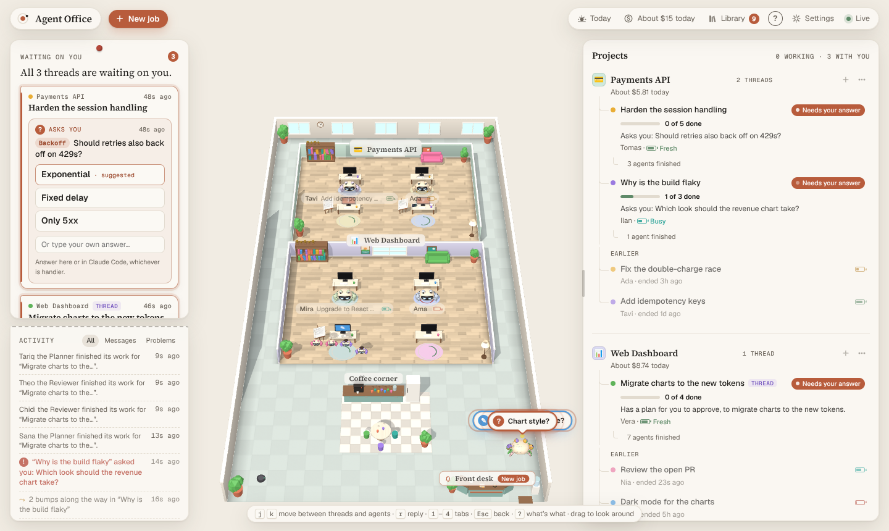

# ModsArena

Claude Code mods and the tools around them.
<br clear="left">

[](https://github.com/tharun-se95/ModsArena/actions/workflows/ci.yml)
[](https://github.com/tharun-se95/ModsArena/releases)
[](LICENSE)

##  Agent Office

**Every Claude Code session on your computer, on one page.**

- **See it all:** each project is a room, and each session is a critter at its desk, with its subagents behind it. A tool call makes its caller hop, and a ring shows how full its context is.
- **Answer what's waiting:** sessions that need you collect in an inbox. Reply, or answer their questions, without finding the right terminal.
- **Talk and run:** read any session's conversation as it happens, message it, pick up one that has ended, or start new work in a project.

**[Try the demo in your browser](https://tharun-se95.github.io/ModsArena/)**: sample activity, nothing to install.



### Requirements

| | |
| --- | --- |
| Claude Code | A build with mods (plugins with hooks). Older builds can use [settings hooks](#settings-hooks) instead. |
| Node | 20 or newer, from [nodejs.org](https://nodejs.org). |
| Computer | macOS, Linux or Windows, the one Claude Code runs on. The office is a page on `127.0.0.1`, so it shows the sessions on that computer, not cloud ones. |
| Browser | Any current one. Without WebGL the rooms don't draw, but the inbox, directory and conversations all work. |

### Install

In Claude Code:

1. **Add the marketplace:** `/plugin marketplace add tharun-se95/ModsArena`
   It says the `modsarena` marketplace was added.
2. **Install:** `/plugin install agent-office@modsarena`
   It says `agent-office` is installed. Start a new session so it loads.
3. **Open it:** type **`/office`**.
   Your browser opens the office, signed in, and this session's critter sits at its desk. Every other Claude Code session on this computer, in any project, joins it from its next event. Past sessions from the last 14 days show as sleeping critters.

On Claude Code 2.1.275 or newer, steps 1 and 2 are one command: `/plugin install agent-office --marketplace tharun-se95/ModsArena`.

New to it? The office's **Tour** walks through it, and **?** explains what you're looking at. The [guide](docs/guide.md) covers everything it shows.

<details>
<summary><b>Just want to look?</b> Run the demo locally.</summary>

```sh
npx github:tharun-se95/ModsArena demo            # sample activity on http://127.0.0.1:7338
```
</details>

### What you can do

- **Watch:** click a critter (or its line in **Projects**) to follow its conversation live, see its team of agents, and see what fills its context.
- **Answer:** **Waiting on you** lists every thread whose next move is yours. Type a reply, or tap an option on a question Claude asked you. Tool approvals still happen in Claude Code: the office can't do anything your permission settings don't already allow.
- **Talk:** the message box under a conversation sends a message to that session or subagent. A session that has ended picks up again in the background (`claude --bg --resume`).
- **Run:** start a new thread in a project, a new project in a folder, or a helper agent for a thread. Describe your own agent types once and reuse them.
- **Tidy up:** **Remove from office** hides a project, thread or agent (with Undo; nothing on disk changes). **Delete for good…** deletes a thread's saved conversation, Claude Code's transcripts, and **can't be undone**. Your project's files are never touched.

See [Talk to your agents](docs/guide.md#talk-to-your-agents) and [Run the office](docs/guide.md#run-the-office) for the details.

### Privacy and security

- **What it reads:** Claude Code's transcripts under `~/.claude/projects` (or `$CLAUDE_CONFIG_DIR`), which hold your full conversations, plus what your sessions report as they work. It keeps the last 8,000 events in memory and writes nothing about them to disk.
- **Where it goes:** nowhere. The bridge listens on `127.0.0.1` only and makes no outbound requests: no telemetry, no analytics, no fonts or scripts from elsewhere. Updates come through Claude Code's own marketplace, not the office.
- **Who can use it:** only your account. The bridge keeps a secret in `~/.claude/agent-office/`, readable by you alone. Your sessions must prove they know it, and so must the bridge before they report to it. The page opens with a key made from it, and then stays signed in with a cookie only the bridge can read. Web pages you visit can't reach it: every request is checked for its address and origin, and anything that changes something needs the page's token.
- **What it changes:** only when you ask on the page. It sends messages to sessions, starts `claude` jobs (without a shell and without permission flags), saves agent types to `.claude/agents/`, and deletes transcripts you choose to delete.
- **The hosted demo** runs in your browser on sample data. It has no bridge and sees nothing of yours.

Found a vulnerability? See [SECURITY.md](SECURITY.md).

### Updating

Type **`/office auto-update`** once: new versions then arrive on their own each time Claude Code starts. (`/office auto-update off` turns that off.) Without it, `claude plugin update agent-office@modsarena` fetches the new version. After an update, run `/office` once to restart the office from it.

### Troubleshooting

Start with **`/office status`**, or in a terminal **`npx github:tharun-se95/ModsArena doctor`**. Doctor checks Node, Claude Code, the bridge, your secret and the hooks, and says what to fix.

| You see | Do this |
| --- | --- |
| `/office` isn't listed | Start a new session after installing: plugins load when a session starts. Where it still isn't listed (before the first message in the desktop app), ask Claude to open the office: the `agent-office:office` skill does it. |
| `/office` says Node is missing or too old | Install Node 20 or newer from [nodejs.org](https://nodejs.org), restart Claude Code, then run `/office` again. |
| "The bridge didn't answer" | Something else may be using port 7337. Run doctor, or pick another port with `/plugin configure agent-office@modsarena` (option `port`). |
| `/office` says the bridge "didn't make way" | An old bridge holds the port and couldn't be stopped. Quit the session that started it (or press Ctrl+C where it runs), then run `/office` again. |
| `/office status` says the bridge is from an older Agent Office | Run `/office`: it restarts the bridge from the version you have now. |
| `/office status` says the bridge "isn't your Agent Office" | Another account or program holds port 7337. Pick another port (option `port`). |
| The page says "Open the office from Claude Code" | That browser isn't signed in yet. Run `/office` once and it opens there signed in. |
| The browser didn't open | Open the address `/office` printed: it carries your key. |
| The office is empty | It fills in as sessions work. Sessions that started before the bridge appear from their next event. |
| A message says "Waiting for the session to pick it up" | That session doesn't have the plugin loaded (settings hooks can't receive messages). |
| A new project says to trust the folder first | Claude Code only works in folders you've trusted, and the office won't trust one for you. Run the command it shows (`cd <folder> && claude`, then say yes), then press Start again. |
| A job fails to start | Check `claude --version` works in a new terminal: jobs run the `claude` on your PATH. |
| A thread shows "Login expired" | Claude Code's sign-in ran out. Run `/login` in Claude Code. |
| No sound | Browsers only play sound after you click the page once. Check **Sound** in the top bar. |
| Something else | The bridge's log is `~/.claude/agent-office/bridge.log`. Start Claude Code with `AGENT_OFFICE_DEBUG=1` for a line per request. |

Still stuck? [Open an issue](https://github.com/tharun-se95/ModsArena/issues/new/choose) with doctor's output.

### Uninstall

1. In Claude Code: `/plugin uninstall agent-office@modsarena`, then `/plugin marketplace remove modsarena` if you don't want the marketplace either.
2. If you installed settings hooks: `npx github:tharun-se95/ModsArena uninstall-hooks` (add `--project` for a project's settings).
3. A running bridge stops by itself after 30 idle minutes, or at once with Ctrl+C where it runs.

What stays behind, to delete if you like:

| Path | What it is |
| --- | --- |
| `~/.claude/agent-office/` | Your secret, its `headers` file and the bridge's log |
| `~/.claude/settings.json.agent-office.bak` | The backup `install-hooks` or `auto-update` made of your settings |
| `.claude/agents/<name>.md` | Agent types you created from the office (they're Claude Code's now) |
| The browser's site data for `127.0.0.1:7337` | What you removed from the office, and your view settings |

### Settings hooks

Claude Code builds without mods can't load the plugin's hooks. Settings hooks get most of the picture: sessions, prompts, subagents, tool calls, and context from the transcript after each turn. They need `curl`. The `/context` breakdown, per-subagent context, cost and rate limits need the plugin, and so does messaging sessions.

```sh
npx github:tharun-se95/ModsArena install-hooks   # adds the hooks to ~/.claude/settings.json (backed up first)
npx github:tharun-se95/ModsArena                 # starts the bridge and opens the office; leave it running
```

`install-hooks --project` writes to `./.claude/settings.json` instead, and `--port N` picks another port. Each hook sends its input to the bridge, waits at most a second, and never blocks or fails a tool call.

### Options

Change them with `/plugin configure agent-office@modsarena`:

| Option | Default | |
| --- | --- | --- |
| `port` | `7337` | The port the bridge listens on |
| `autoStart` | `true` | Start the bridge when a session starts and none answers |

### Learn more

- [The guide](docs/guide.md): everything in the office, talking to agents, running work, and how it works inside
- [Compatibility and stability](docs/compatibility.md): what's supported, and what won't change without a major version
- [CONTRIBUTING.md](CONTRIBUTING.md): build, test and release
- [CHANGELOG.md](CHANGELOG.md)

Agent Office is a community project. It isn't made or endorsed by Anthropic.

## License

[MIT](LICENSE)
