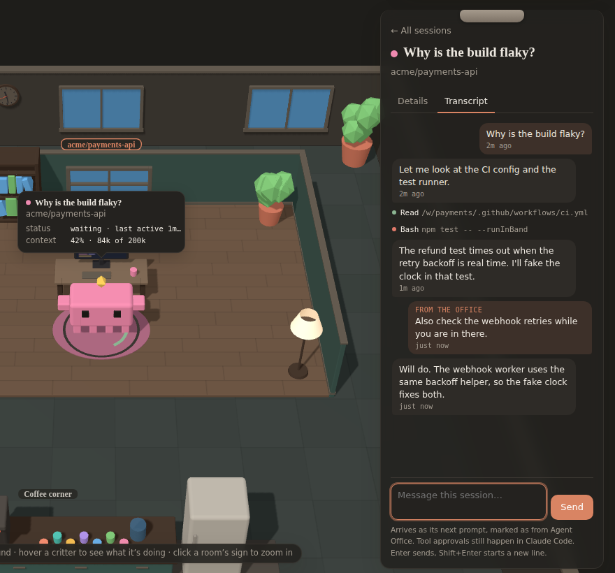

# Agent Office guide

Everything the office shows, how to talk to your agents from it, and how it works inside. For installing, see the [README](../README.md).

## What you're looking at

| In the office | What it is |
| --- | --- |
| The office | Carpet tiles, outer walls with tall windows, plants that sway, a water cooler and a robot vacuum doing laps of the open floor, all around the rooms. The windows follow your local time (dawn, day, golden hour, dusk, night), the lamps glow brighter after dark, and the wall clock shows the time. The floor arranges itself to fill your window. |
| Coffee corner | A shared kitchenette: a counter with a steaming coffee machine and a row of mugs, a fridge, and a round table with stools. Finished subagents walk here along the aisles, pick up a mug, take a few sips, and then head off. |
| Room | A project: a git repository (worktrees included) or a folder outside one. Each room has a wooden floor, walls in its own color, and furniture (a bookshelf, a window, plants, a lamp, sometimes a couch). What a room holds and its wall color come from the project's name, so it always looks the same. Its sessions sit in a small grid. Click the sign over the back wall to zoom in, and press Esc to see every room again. |
| Crab on a rug, with a gold gem | A live chat session, named by its first prompt. Each session gets its own color, worn on its claws and legs. Its glowing visor face shows how it's doing: happy, thinking, laughing, sad, surprised when its context is nearly full, sleepy at rest. Its desk's monitor scrolls code while it works, dims while it waits, and is off for past sessions. Its legs tap and its claws clack while it works, and the gem glows and spins faster. It hops on each prompt and each tool call, and it turns toward the subagent that acted last. |
| Ring on the rug around it | How full that context window is: green, then amber past 60%, then red past 85%. A pulsing red ring, and both arms up, mean it's past 80% and will compact soon. |
| Smaller crabs behind its desk | Subagents, standing in a row behind the desk (then a second row, then either side), so they never overlap. Each type has its own color and kit: **Explore** is sky blue with a backpack; **Plan** is lilac in a beret; **code-reviewer** is pink in round glasses; **test-runner** is mustard with headphones; and **general-purpose** is the plain green crab. Prefer the classic blocky Claude bots? **Settings → Critters** switches back. Your own agent types get a color from their name. They drop in when started (the session waves hello), and when finished they wave goodbye and walk to the coffee corner. |
| Grey critter with closed eyes | A past session from the last 14 days, read from its transcript. Each room shows the three most recent, and its sign counts the rest. Untick **Past sessions** to hide them. |
| Bead rising off a critter | A tool call, colored by what it does: reads sky blue, edits coral, searches green, web lookups lilac, shell commands mustard, handoffs teal. A red bead means the call failed. |
| Ripple across the rug | The session just compacted its context. |
| A session walking in | A session that starts while you watch walks in from the front of the office to its desk. |
| Confetti | The session just finished a turn. |
| Red "!" and a wobble | A tool call just failed. |
| "zzz" | A session that's been idle for two minutes has dozed off, and past sessions are asleep. |
| Steam over a desk mug | That session is working right now. |
| A wave | Two critters passing each other on the way in or to coffee say hi. |

**Sounds:** soft key taps when a tool runs, a two-note chime when a turn finishes, a bonk when a call fails, a pop when a helper arrives, a chirp when critters wave, a clink at the coffee corner and a hush on compaction. They're synthesized in the browser (no audio files), start after your first click or key press, and the **Sound** button in the header mutes them (it remembers your choice).

Hover any critter (or its line in the directory) for a bubble with what it is and what it's doing: its status, the tool it's running, its context use, model and tool calls, and who it works for. Session names and room signs stay small and quiet; a name that would collide with another, with a sign or with the bubble steps aside.

Floating over the office (and framed around, so the office always sits in the space they leave free):

- **Waiting on you** (top left): a letter for each thread whose next move is yours, longest waiting first, with what it last said and a reply line. Type and press Enter: the reply becomes that thread's next prompt. A thread whose last turn ended on an error is marked **Needs a look**; context windows past 80% are listed under the letters.
- **Activity** (bottom left): the moments so far, filterable to **Messages** (who messaged whom: the lead to its agents, agents to each other, a claude.ai project's coordinator to its thread) or **Problems**.
- **Projects** (right): each project's threads with their state (**Working**, **Waiting on you**, **Needs a look**), context use and what each is doing, and under each thread its live team, nested the way the lead spawned them.

Click a critter, a letter or a line and the camera glides to its room while the directory turns into a clipboard, with a trail back up (project › thread › agent) and three tabs:

- **Conversation:** its transcript, live, with a box to message it (see below).
- **Team:** the lead and every agent it spawned, nested, with each one's state (working, waiting on its own background work, idle, done, stopped), and the messages between them.
- **Details:** context use and what fills it (the `/context` breakdown); turns, tool calls, errors, cost, model and rate limits; the files it has read and edited, its recent actions in plain words, and what you asked it.

**Keys:** <kbd>j</kbd>/<kbd>k</kbd> (or the arrows) walk every thread and agent in order, <kbd>1</kbd> <kbd>2</kbd> <kbd>3</kbd> switch tabs, <kbd>r</kbd> replies (to what's open, or to the thread that has waited longest), and <kbd>Esc</kbd> goes up a level.

A session that a [claude.ai project](https://code.claude.com/docs/en/claude-projects) runs on your computer (through Remote Control) is marked as a **thread**, and its coordinator's messages show up as mail. Threads that run in the cloud never touch your machine, so the office can't see them.

On a narrow screen the inbox becomes a strip under the top bar and the directory a sheet at the bottom.

## Talk to your agents

Open a critter's clipboard: the **Conversation** tab is its transcript, live. Your prompts sit on the right and its replies on the left. Tool calls are one line each, green or red once they finish; click one to see what came back. It's read from the transcript Claude Code keeps, so past sessions and subagents have one too.

The box at the bottom sends it a message:

- **To a session:** the message becomes its next prompt, marked as from Agent Office. If the session is mid-turn, it waits until that turn ends.
- **To a subagent:** the message goes to that subagent directly. A finished one is resumed to answer, which uses tokens.
- **To a session that has ended:** the message picks the same session up again in the background, in its own folder (`claude --bg --resume`), and its critter comes back to its desk to answer in the same conversation. That uses tokens like any turn.
- **Hand it on:** drag a letter from **Waiting on you** (a thread's last answer), or anything a thread made (a picture, pull request, artifact or file card), onto any critter. A note opens with the message worded for it; edit it if you like and send. From the keyboard, focus the card and press **H** to pick who gets it.
- **@mentions:** in a reply, type **@** to pick one of the thread's agents by name; the message goes to that agent instead of the thread.
- **Quick actions** under a thread's name: **Explain what you did** and **Wrap up** send a ready-worded message; **Stop** (it asks once more) ends the turn a session is running, as Esc would in Claude Code. A single subagent can't be stopped from the office.

Enter sends and Shift+Enter starts a new line.



The message stays on the clipboard with its status until it shows up in the transcript, and the reply appears below it. Tool approvals still pop up in Claude Code itself: chat can't do anything your permission settings don't already allow. It needs the plugin; the settings-hooks fallback can't receive messages. In the demo, messages get a sample reply.

**Answering from the office.** When Claude asks you a question (with options to pick from), it shows up as a card in **Waiting on you** and in the critter's speech bubble. Tap an option, or type your own answer, and the thread carries on. Claude Code's own question stays open in the terminal the whole time, so you can answer wherever is handier: whichever answer comes first counts. A plan waiting for approval can be sent back from the office with a note ("keep planning"), but approving one has to happen in Claude Code, since only Claude Code can switch Claude out of planning. This needs the plugin, like messages.

**How it's kept safe.** The bridge only listens on `127.0.0.1`, but any web page you visit can send requests there, so:

- **Host check:** every request must be addressed to the bridge itself. This stops a page pointing its own hostname at your machine to read the answers (DNS rebinding).
- **Origin check:** browser requests that change anything must come from the office page.
- **Token:** sending a message also needs a secret token the bridge makes fresh each time it starts and gives only to the office page.
- **Your account only:** the bridge keeps a secret in `~/.claude/agent-office/` that only your account can read. Your sessions send it with what they report, and the bridge proves it knows it before they send anything, so another account on a shared computer can neither feed the office nor pose as it. The page opens with a key made from it (`/office` puts it in the address), and the browser then stays signed in with a cookie only the bridge can read.
- **Only its own script:** the page carries a strict Content-Security-Policy, can't be framed by another page, and loads nothing from anywhere else (its fonts ship with it).

See [SECURITY.md](../SECURITY.md) to report a vulnerability.

## Run the office

The office can start work too, not just show it. Everything here runs `claude` on your computer, with your permission settings.

- **New thread:** the **+** beside a project starts a new thread there, from what you type on the front desk.
- **New project:** **New project** on the front desk starts a job in a folder the office hasn't seen yet, or makes one inside your home folder. Claude Code only works in folders you've trusted, and the office never trusts one for you: if it isn't yet, the desk shows the one command to run once (`cd <folder> && claude`, then say yes), and the job starts when you press Start again.
- **Helpers:** a thread's **⋯** menu can **bring in a helper**: pick an Explorer, a Planner, an All-rounder or one of your own agent types, say the task, and the thread starts a subagent for it.
- **Your own agent types:** **New agent type** on a project's **⋯** menu describes a kind of agent once (name, when to use it, instructions, and optionally its tools), for that project or all of them. It's saved where Claude Code reads agents (`.claude/agents/<name>.md`), never over one that's there.
- **Remove from office** puts a project, thread or agent away, with Undo; **Settings** lists what's removed so you can bring it back. Nothing on disk changes.
- **Delete for good…** asks once more, then **deletes its saved conversation**: Claude Code's transcripts for that thread (and its subagents), or for every thread of a project. This can't be undone, and `claude --resume` can't pick those sessions up afterwards. A project's own files are never touched, and a session still open in a terminal is left alone.

## How each thing is measured

| What | Mod (live) | Settings hooks (fallback) | Past sessions |
| --- | --- | --- | --- |
| Project | `$.session.repo()` root, named by the bridge from `origin` | git root of `cwd` | git root of the transcript's `cwd` |
| Session context | `session.measure` (live), `turn.step` (every request) | transcript tail on each `Stop` | last main-loop request in the transcript |
| What fills it | `$.session.usage({ breakdown })` after each turn | no | no |
| Subagent context | `turn.step` inside the agent's loop | no | `subagents/*.jsonl` |
| Compactions | `session.compact`, with tokens before and after | `PreCompact` | `compact_boundary` rows |
| Cost and rate limits | `session.measure` | no | the transcript's `cost-state` row |

A request's context is what it was answered over: uncached input plus cache reads plus cache writes. The transcripts don't record the window size, so the bridge reads 1M for models with `[1m]` in their id or for any reading past 200k, and 200k otherwise.

## How it works

```
Claude Code ──(mod hooks / settings hooks)──► bridge :7337 ──(SSE)──► the office (browser, Three.js)
~/.claude/projects/*/*.jsonl ─────────────────►   └─ GET /history
```

- **`agent-office/`** is the Claude Code plugin (a mod), listed in this repository's marketplace (`.claude-plugin/marketplace.json`). It hooks `session.start`, `session.measure`, `session.compact`, `turn.step`, `turn.start`, `turn.complete`, `agent.spawn` and `tool.call`. Every tool call is attributed to the agent loop that made it (`agentId`), and every subagent to its parent (`parentAgentId`). Hooks run in a sandbox without Node, so events are queued in memory and flushed to the bridge every 250 ms with `$.http.fetch`. Context readings are coalesced so only the newest is sent, and a tool call never waits on the visualizer. On session start the mod also starts the bridge (`$.process.spawn`, with `--background`, so it runs on after that session ends and stops by itself after 30 idle minutes) if none is running, and `/office` waits for it before opening the page.
- **`agent-office/server/`** is the bridge, plus `cli.mjs` (what `npx github:tharun-se95/ModsArena` runs) and `settings-hooks.mjs` (the settings-hooks installer). It uses only Node built-ins and has no dependencies. It accepts events on `POST /event` and keeps the last 8,000, plus the newest context reading per session and agent. It streams them to browsers over Server-Sent Events and replays the backlog when a browser connects. `GET /history` summarizes recent transcripts, cached by file modification time. `GET /transcript` follows one session's or subagent's transcript from a byte offset (`transcript.mjs`). `POST /chat` queues a message from the office, and the session's mod collects it from `GET /inbox` (`chat.mjs`, with the checks in `guard.mjs`). `POST /answer` takes an answer to a question a session is holding, under the same checks, and the session's mod waits for it on `GET /answer/wait` (`asks.mjs`). One bridge serves every session on the machine. `GET /healthz` reports its version; a bridge the mod started (`--managed`) steps down on `POST /shutdown` when a newer copy's bridge starts with `--replace`, so an update doesn't leave the old one serving the old page. It strips any credentials from remote URLs before showing them.
- **`visualizer/`** is the page's source, in plain Three.js: `model.js` turns events into projects, sessions, agents and tools; `words.js` turns the same events into sentences; `table.js` lays out the office and animates the critters (`office.js` builds the rooms, desks, coffee corner and office shell; `character.js` builds each critter, `crab.js` the robot crabs, with their kits from `crab-kits.js`); and `panels.js` writes the columns around it. Colors come from CSS tokens on the page, so it follows your light or dark setting. It's built into `agent-office/server/public/app.js`, which is committed, so running it needs only Node; CI checks the committed file matches its source.
